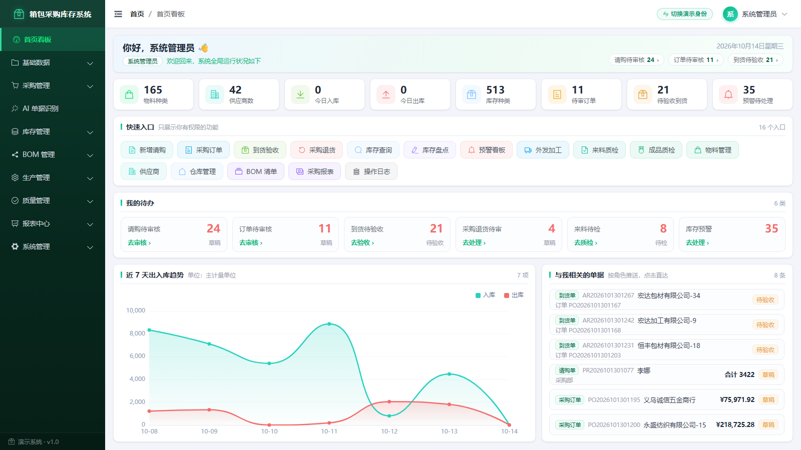
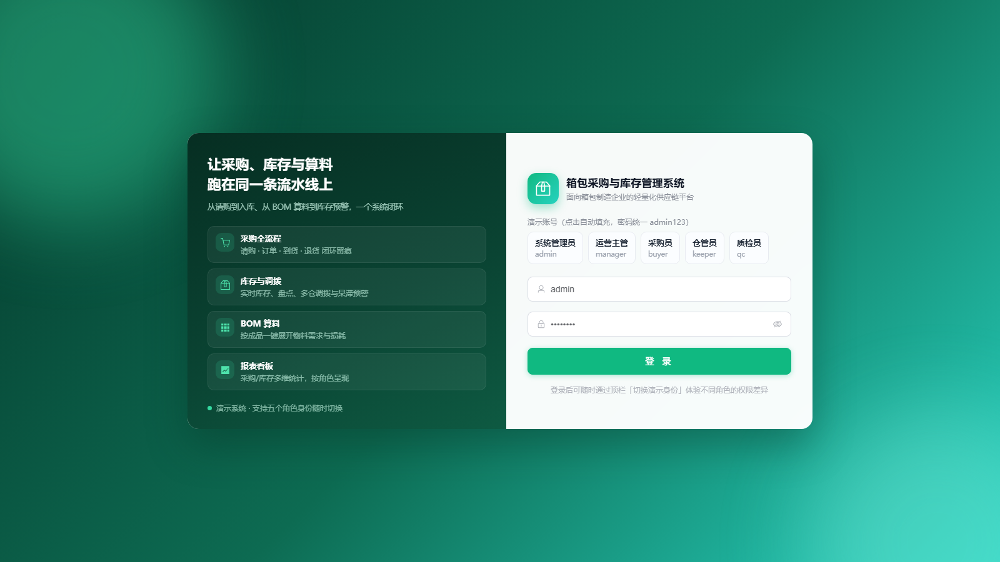
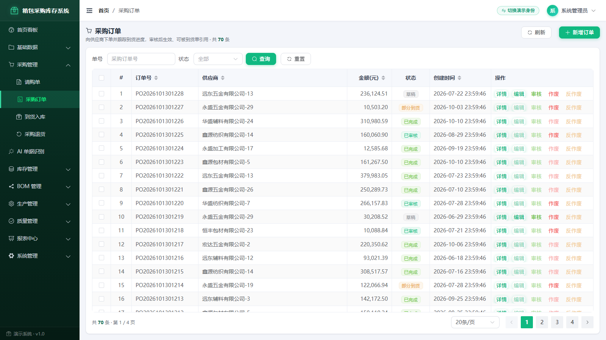
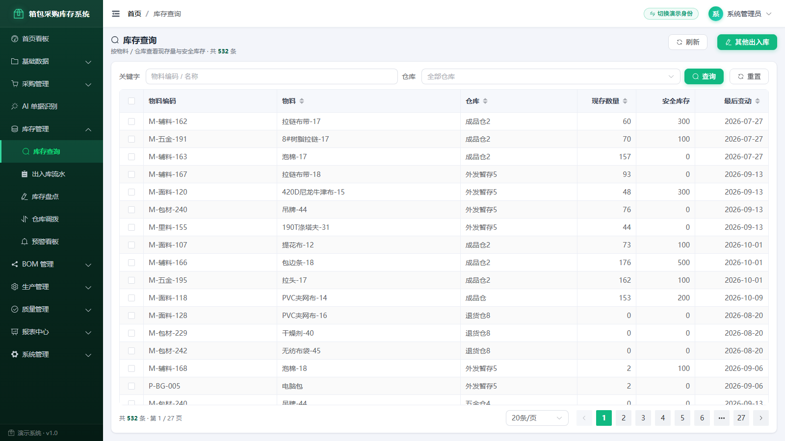
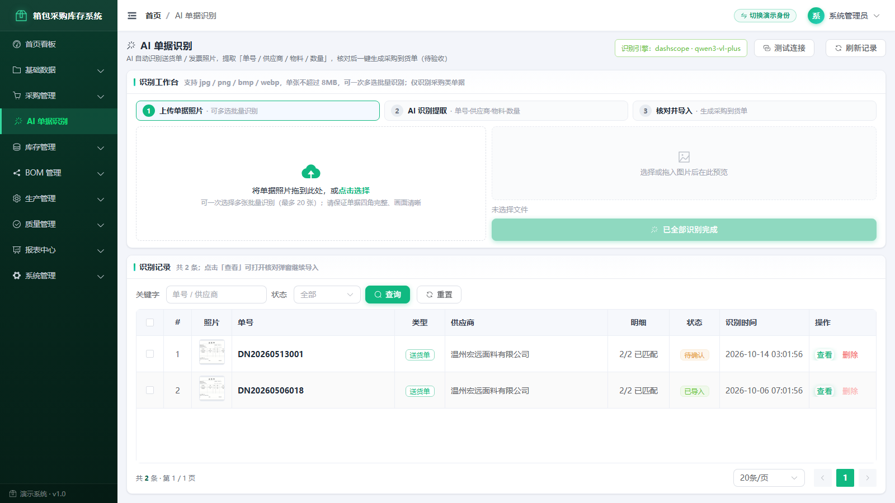

# 箱包采购与库存管理系统 · v0.1.0-preview.1 开发预览候选

用于本机演示采购、库存及受限审计界面，并复现 B-002 数量纯核心的合成测试。**本版本是受限的 GitHub 开发预览，不适用于真实经营判断或正式审计结论。**

**当前状态：三批稳定化及DEP-IR-01均已通过本聊天审核，最终候选材料待最终审核；尚未提交或发布。** 拟版号为 `v0.1.0-preview.1`，2026-11-02只读检查时未发现同名GitHub标签或Release；未创建标签，检查不构成版号预留。本次仅更新README与发布说明并制作独立候选目录、ZIP及公开校验旁件，不改变依赖、业务源码、测试或数量门禁。

| 证据来源 | 当前认可范围 | 不能扩大的结论 |
| --- | --- | --- |
| 程序员实际执行 | 第一批依赖/前端验证；第二批两环境安装、兼容性及数量回归；第三批实际本机监听、专用浏览器登录及五页面读取、版本与未知值核对 | 不等于全部业务、所有角色或生产安全通过 |
| 本聊天证据核验及产品决定 | 第一批、DEP-IR-01、第二批、第三批已审核并确认关闭；保留原始成功/失败日志及限制 | 证据审核不冒称审核方独立重跑全部安装、服务、浏览器或测试 |
| 本轮复用 | 第二批242方法/585subTest、13方法/10subTest兼容性；第一批前端5项及native构建；第三批启动和五页面证据 | 本次材料整理不重新运行这些测试、安装或启动 |
| 仍未验证/未批准 | 全部角色和写流程、打印导出、其他平台、真实来源/审批、真实AI/OAuth、生产规模、全量供应链/许可证及正式审计资格 | 不代表完整WP-3、C02、数据库迁移或正式生产准入 |

原项目已经迁移。本聊天已按新路径核对1677项保护对象一致，本次继续以新旧根路径映射只读复核；具体私人路径仅留在私人保护记录，历史证据仍保留其原始旧路径，未改写。此核验不等于原业务数据内容获得审计采信。


本独立分支最初基线为远端 main `120473cee0a387d483e8d93874ce537ecfcd52ef` 的 **241 个文件**；独立 `codex/preview-dependency-safety-20261102` 分支在第一批新增 4 个必要的约束／验证文件，本地候选源文件集合为 245 项，尚未提交、推送或发布。基线包含：此前审核的 192 文件代码／文档快照，加按用户要求恢复的 42 张界面截图和 7 份演示单据样张。历史配套和演示素材纳入不代表全部通过 WP-3 或页面验收。原公开仓库 [LiutaiyuaN2279/bag-inventory-system](https://github.com/LiutaiyuaN2279/bag-inventory-system) 保留提交历史，仍有 78 个旧文件不在当前版本中；这不是历史清理或全历史安全审核。原 `.git`、内部证据和私有数据不进入发布包，不强制推送或镜像推送。此前 192 文件 ZIP 及校验值仍只对应旧包；本次素材恢复未创建新的 GitHub Release。范围与验证限制见 [GitHub开发预览版发布说明](docs/GitHub开发预览版发布说明.md)。


## 演示截图与单据样张

以下为既有演示素材，用于了解界面和查看样例，不代表本轮已经重新验证所有页面、角色权限或真实业务流程。

[查看全部42张界面截图](docs/screenshots/) · [查看全部演示单据样张](test_docs/)

| 功能看板 | 登录界面 |
| --- | --- |
|  |  |
| 采购订单 | 库存查询 |
|  |  |
| AI单据识别 | 岗位看板对照 |
|  |  |

演示单据：

- [送货单测试样张](test_docs/送货单_测试样张.png)
- [住宿费专票图片](test_docs/rmb/住宿费专票_上海1650元.png)
- [出租车收据](test_docs/rmb/收据_出租车360元.png)
- [火车票](test_docs/rmb/火车票_杭州至上海.png)
- [餐饮发票](test_docs/rmb/餐饮发票_杭州2400元.png)
- [住宿费专票扫描件PDF](test_docs/rmb/住宿费专票_扫描件.pdf)
- [住宿费专票文本型PDF](test_docs/rmb/住宿费专票_文本型.pdf)

这些静态文件只作为演示样张，不是系统已核验的业务原件。查看或使用样张仍须遵守下文的本机可信数据、浏览器隔离和已知PDF依赖风险限制。


## 可以体验什么

- 管理员演示登录；首页看板、物料、采购订单、库存查询。
- 审计工作台的受限试算、限制披露及运行版本查询。R03/R10 证据不足时停算，未知值保留为未知。
- WP-1 输入／版本边界、WP-2 片段／限制映射、WP-3 首批内部 V2 数量候选路径的纯核心合成回归。

**两个公开数量入口 `evaluate_delivery_scope`、`summarize_delivery_facts` 对合法 V2 仍返回 `quantity_contract_not_ready`。** 内部候选结果为 `synthetic_only`、`formal_eligible=False`，没有接入真实来源、审批或正式业务 API。

界面中的旧 R01—R10 试算线索不代表最新日期设计已全部实现；其中旧 R04 不是已确认的六个月历史中位数规则。界面原有“v1.0”字样也不是正式审计或生产准入声明。

## 本机演示：Windows PowerShell

既有程序员验证环境为 Windows、Python **3.12.14**、Node.js **24.21.0**、npm **11.19.0**。其他平台／版本未验证。后端直接依赖见 `backend/requirements.txt`；前端使用 `package-lock.json` 和 `npm ci`。独立审核确认离线新装成功，**不等于在线下载独立通过**；下列在线安装命令用于复现，不据此增加验证结论。运行阶段只使用本地演示服务。2026-11-02 稳定化第一批在独立目录完成公开依赖正常安装与受限自测；这属于程序员实施证据，不代替独立审核。后端新增 Windows／Python 3.12 解析约束，其他平台和 Python 版本未验收。

**先将经过评审的候选包解压到全新目录。以下命令仅在该目录执行，不要在含业务数据、旧 `.env` 或私人附件的目录运行。** 不复制本项目原数据库、备份或运行环境。

```powershell
# 终端一：当前目录必须是全新解压的候选根目录。
$demoRoot = (Get-Location).Path
if (Test-Path -LiteralPath "$demoRoot/backend/.env") { throw '发现旧环境文件，停止' }
if (Test-Path -LiteralPath "$demoRoot/backend/data") { throw '发现已有数据目录，停止；请换全新目录' }
if (Get-NetTCPConnection -LocalPort 8000,5173 -State Listen -ErrorAction SilentlyContinue) { throw '演示端口已占用，不停止已有服务' }

py -3.12 -m venv .preview-venv
if ($LASTEXITCODE -ne 0) { throw '创建虚拟环境失败' }
$previewPython = "$demoRoot/.preview-venv/Scripts/python.exe"
& $previewPython -m pip install --index-url https://pypi.org/simple --upgrade pip==26.2.2
if ($LASTEXITCODE -ne 0) { throw '安装工具升级失败' }
& $previewPython -m pip install --index-url https://pypi.org/simple -r "$demoRoot/backend/requirements.txt"
if ($LASTEXITCODE -ne 0) { throw '后端依赖安装失败' }

# 明确覆盖运行配置，不从旧终端继承业务库、AI 或 OAuth 凭据。
$env:DATABASE_URL = 'sqlite:///' + ((Join-Path $demoRoot 'backend/data/app.db') -replace '\\','/')
$env:UPLOAD_DIR = Join-Path $demoRoot 'backend/data/uploads'
$env:AUDIT_TRIAL_ARCHIVE_DIR = Join-Path $demoRoot 'backend/data/audit_trials'
$env:SECRET_KEY = [guid]::NewGuid().ToString('N') + [guid]::NewGuid().ToString('N')
$env:AI_OCR_PROVIDER = 'mock'
$env:AI_OCR_API_KEY = ''
$env:AI_OCR_BASE_URL = ''
$env:AI_OCR_MODEL = ''
$env:GITHUB_OAUTH_ENABLED = 'false'
$env:GITHUB_CLIENT_ID = ''
$env:GITHUB_CLIENT_SECRET = ''
$env:OPLOG_RETENTION_DAYS = '0'
$env:PYTHONDONTWRITEBYTECODE = '1'
$env:PYTHONPATH = Join-Path $demoRoot 'backend'
Set-Location "$demoRoot/backend"
& $previewPython -B scripts/init_db.py
if ($LASTEXITCODE -ne 0) { throw '初始化失败' }
& $previewPython -B scripts/seed_data.py
if ($LASTEXITCODE -ne 0) { throw '演示数据生成失败' }
& $previewPython -B -m uvicorn app.main:app --host 127.0.0.1 --port 8000
```

仅初始化新演示库，不执行重置、升级、迁移或历史回填脚本。演示账号 **admin / admin123**，只供本机使用；不可向公网开放。种子日期相对生成当天，不保证不同日期生成的数据库字节一致。演示单据样张位于 `test_docs/`，不会自动绑定到种子数据或成为业务原件；模拟 OCR 记录仍可能显示“原件未留存”，不代表 OCR 服务或真实来源验证通过。

```powershell
# 终端二：进入同一个全新候选目录的 frontend 子目录。
npm ci --no-audit --no-fund
if ($LASTEXITCODE -ne 0) { throw '前端依赖安装失败' }
npm run dev -- --host 127.0.0.1 --port 5173 --strictPort
```

### 首次打开页面之前：新建专用浏览器配置（PREVIEW-01）

先完成上面的新目录／本机服务配置，**不要先用日常浏览器打开任何候选页面，包括登录页和服务器设置页**。`bag_server_base` 残留在浏览器 localStorage 中可能改写请求地址；新解压源码目录不会清除同源浏览器状态。页面打开后才清理 localStorage 不能作为隔离前提。

在第三个 PowerShell 终端执行以下步骤；仅创建并使用这次全新的专用配置，不复用日常配置或既有浏览会话：

```powershell
$previewProfile = Join-Path $env:LOCALAPPDATA ('BagPreview-' + [guid]::NewGuid().ToString('N'))
$previewEdge = Join-Path ${env:ProgramFiles(x86)} 'Microsoft/Edge/Application/msedge.exe'
if (-not (Test-Path -LiteralPath $previewEdge)) { throw '未找到 Edge，请先确认独立配置启动方式；不要改用日常会话' }
if (Test-Path -LiteralPath $previewProfile) { throw '配置目录已存在，停止' }
New-Item -ItemType Directory -Path $previewProfile -ErrorAction Stop | Out-Null
# 第一次只打开空白页，不带任何候选页面 URL。
& $previewEdge "--user-data-dir=$previewProfile" --no-first-run --no-default-browser-check --disable-sync --disable-extensions --disable-background-networking about:blank
# 先在新窗口的 edge://version 核对“个人资料路径”位于 $previewProfile 下。
# 确认后，才在该窗口地址栏手动输入 http://127.0.0.1:5173/#/login。
```

不要登录浏览器账号、导入服务器地址／登录状态／扩展或同步配置；不要点击旧窗口中的候选链接。仅访问本机演示地址，**不设置远程服务器地址**。若无法确认新配置实际生效或组织策略阻止隔离，应停止演示，不能回退到日常配置。以上是操作者必须落实的隔离步骤，**不是应用已具备强制本机隔离**。

健康检查为 `http://127.0.0.1:8000/api/health`；如用浏览器查看，也只在上述专用窗口访问。前端开发代理指向本机 8000。两端须配套使用，旧审计客户端会被版本门禁拒绝。验证结束关闭专用窗口，并用服务终端的 Ctrl+C 停止服务，不保留对外监听。

## 可复现验证

```powershell
# 前端目录：锁定依赖安装后。
# 独立审核环境已验证的构建方式；不修改 vite.config.js 或 package.json。
npm run build -- --configLoader native
node --test tests/audit-p0.test.js

# 后端目录：使用上面新建的 Python 环境。
$env:PYTHONPATH = (Get-Location).Path + ';' + (Join-Path (Get-Location).Path 'tests')
& ../.preview-venv/Scripts/python.exe -B scripts/verify_preview_core.py
```

验证来源必须分开：独立审核确认离线新装、`--configLoader native` 构建和进程内接口验证通过；默认 `npm run build` 在审核环境受限。程序员原日志记录默认构建、实际本机监听与五页面成功并已被审阅，**实际监听与五页面没有独立复跑**。native 命令适用于该审核环境及既有 Vite 6.4.3 原生可加载配置，不等于所有运行环境或默认构建都已独立通过。

2026-11-02 稳定化第一批（已审核历史）自测记录：**242 个核心方法、585 个实际 subTest，失败／错误／跳过均 0；原前端 5 项通过；native 构建通过。** 新增 `scripts/verify_preview_core.py` 在加载四个既有测试模块之前禁止文件写入、数据库、网络、子进程及文件系统变更；原测试和断言未修改。8 项新增正常兼容性测试在另一个允许隔离合成数据写入的进程执行：首轮 PDF 渲染因缺 Pillow 出错，补入必要依赖后原断言复测全部通过。失败日志保留，不执行高消耗漏洞攻击，不以进程内验证冒充本轮实际监听／五页面复跑。

TV-01 曾经获得授权迁移一个 `kind="scope"` 子案例的预期，其旧触发输入保留；不能描述为全部旧断言未变。原 89 项后端历史测试未在本轮迁移或执行，不属于这 242 个方法；原前端 5 项保持，第一批执行日志保留，第二批未重跑。数量不能代替完整规格覆盖结论。

## 第一批依赖安全整改历史（已审核，旧扫描结果保留）

本节版本变化和46条扫描描述为第一批历史，不是第二批环境当前状态；第二批结果见下节。

| 依赖 | 基线 → 本批明确版本 | 选择依据 |
| --- | --- | --- |
| FastAPI | 0.115.6 → 0.162.0 | 旧版要求 Starlette `>=0.40.0,<0.42.0`；新版元数据要求 `starlette>=0.46.0`、`pydantic>=2.9.0`，与本批显式组合相容 |
| Starlette | 0.41.3 → 1.10.0 | 不在以下两条目标公告受影响范围，且正常依赖解析及 `pip check` 通过 |
| pypdf | 5.1.0 → 6.21.4 | 不在以下 PDF 目标公告 `<6.6.0` 范围；现有文本读取路径实际验证通过 |
| Pillow | 原声明缺失 → 13.0.0 | 干净环境暴露现有 PDF 渲染的 `bitmap.to_pil()` 缺依赖；仅补依赖，不修改渲染业务代码 |

官方公告及原风险保留为整改依据：

- [Starlette multipart：GHSA-2c2j-9gv5-cj73 / CVE-2025-54121](https://github.com/Kludex/starlette/security/advisories/GHSA-2c2j-9gv5-cj73)：大文件表单可阻塞事件线程，公告修复版本 0.47.2。
- [Starlette Range：GHSA-7f5h-v6xp-fcq8 / CVE-2025-62727](https://github.com/Kludex/starlette/security/advisories/GHSA-7f5h-v6xp-fcq8)：原 0.41.3 位于 0.39.0—0.49.0 受影响范围，特制 Range 请求可使 FileResponse／StaticFiles 耗尽 CPU；修复版本 0.49.1，multipart 的 0.47.2 不能替代这个要求。
- [pypdf：GHSA-4xc4-762w-m6cg / CVE-2026-22690](https://github.com/py-pdf/pypdf/security/advisories/GHSA-4xc4-762w-m6cg)：原 5.1.0 的非严格读取可能在畸形 PDF 上长时间运行，修复版本 6.6.0。

版本及兼容约束以 [FastAPI 元数据](https://pypi.org/pypi/fastapi/0.162.0/json)、[Starlette](https://pypi.org/project/starlette/1.10.0/)、[pypdf](https://pypi.org/project/pypdf/6.21.4/) 为依据。本批没有仅提升到上述旧公告的最低修复版，也不据“当前版本较新”宣称没有其他漏洞。

`requirements.txt` 引用 `constraints-py312-windows.txt`，锁定本次实际解析的 34 个应用／验证包版本；约束不会主动安装仅供验证的 HTTPX。验证环境另用 `requirements-verify.txt`；pip 工具版本单独记录，不属于运行依赖锁。第二个全新环境按最终声明和约束正常安装并通过 `pip check`，没有强装冲突版本或使用 `--no-deps`。这不是跨平台或带完整制品哈希的供应链锁。

**扫描仍有风险，不能称为全量安全通过。** 2026-11-02（北京时间）使用独立工具环境的 pip-audit 2.10.1／默认 PyPI 公告服务，扫描运行／验证环境 site-packages 的 35 包（含 pip）：目标三项未命中，但原始输出仍有 46 条记录，分布于 pip 25.0.1、PyJWT 2.10.1、python-multipart 0.0.20；记录含重复，按公告 ID 去重为 29 项，未按 CVE／别名进一步归并。扫描返回码 1 保留，未隐藏或忽略公告。Starlette multipart 公告的处置不等于 python-multipart 或整个上传栈已无其他风险；这些额外风险本批未处置。

本版仍**仅限本机、可信合成数据，不处理不可信文件（包括 PDF），不对外监听**。本批扫描不覆盖前端 npm、操作系统、浏览器、PDFium 内嵌原生组件的完整漏洞、安全配置或许可证；全量供应链与许可证审核未完成。HTTPX 0.28.1 在新 Starlette TestClient 中有弃用警告，当前验证通过不代表未来版本兼容。真实 AI、OAuth 和业务审批没有接入或验证。

### 复现新增兼容性测试

仅在独立候选的 backend 目录、全新测试终端运行；不启动服务、不使用旧 `.env`，所有数据放到新测试目录：

```powershell
& ../.preview-venv/Scripts/python.exe -m pip install -r requirements-verify.txt
if ($LASTEXITCODE -ne 0) { throw '验证依赖安装失败' }
$compatRoot = Join-Path (Resolve-Path '..').Path ('compat-runtime-' + [guid]::NewGuid().ToString('N'))
New-Item -ItemType Directory -Path $compatRoot -ErrorAction Stop | Out-Null
$env:PREVIEW_TEST_ROOT = $compatRoot
$env:DATABASE_URL = 'sqlite:///' + ((Join-Path $compatRoot 'app.db') -replace '\\','/')
$env:UPLOAD_DIR = Join-Path $compatRoot 'uploads'
$env:AUDIT_TRIAL_ARCHIVE_DIR = Join-Path $compatRoot 'audit_trials'
$env:AI_OCR_PROVIDER = 'mock'
$env:AI_OCR_API_KEY = ''
$env:AI_OCR_BASE_URL = ''
$env:AI_OCR_MODEL = ''
$env:GITHUB_OAUTH_ENABLED = 'false'
$env:GITHUB_CLIENT_ID = ''
$env:GITHUB_CLIENT_SECRET = ''
$env:SECRET_KEY = [guid]::NewGuid().ToString('N') + [guid]::NewGuid().ToString('N')
$env:OPLOG_RETENTION_DAYS = '0'
$env:PYTHONDONTWRITEBYTECODE = '1'
$env:PYTHONPATH = (Get-Location).Path
& ../.preview-venv/Scripts/python.exe -B -m unittest discover -s tests -p test_preview_dependency_compat.py -v
```

上述兼容性进程会在全新目录创建合成演示库及小型上传文件，不是迁移；纯核心进程的禁止 I/O 条件不因此放宽。正式业务权限、独立审核和公开数量入口门禁不变。

## 稳定化第二批：上传、JWT与安装工具（2026-11-02，已通过本聊天独立审核）

本批沿用 `codex/preview-dependency-safety-20261102`；仅改后端 requirements、现有约束、兼容性测试及两份说明。没有新增候选源文件，245文件集合保持；原242测试、DEP-IR-01已审核验证脚本、9份数量核心及49份演示素材不变，数量公开入口仍为 `quantity_contract_not_ready`，内部仍为 `synthetic_only`、`formal_eligible=False`。未提交、推送、合并、发布或迁移。

| 项目 | 第二批实际版本／结果 |
| --- | --- |
| 应用依赖 | python-multipart 0.0.20 → **0.0.31**；PyJWT 2.10.1 → **2.15.0**；其余应用／验证依赖版本不变 |
| 安装工具 | 全新环境A、B各安装 **pip 26.2.2**；不加入应用requirements或约束；旧环境及证据不覆盖 |
| 约束依据 | python-multipart 0.0.31要求Python>=3.10；PyJWT 2.15.0要求>=3.9；pip 26.2.2要求>=3.10；现用FastAPI/Starlette声明的multipart下界0.0.18无冲突；本批Python3.12.14正常解析安装 |
| 两环境 | A/B最终35个包版本及Python一致，均正常安装、pip check通过；功能测试在A执行，B用于从零重建及一致性检查，不冒充B已执行全部功能测试 |
| 兼容性 | **13方法、10个实际subTest，失败/错误/跳过0**；前批8方法及全部断言保留，新增5方法；涵盖正常/磁盘暂存上传、文件响应、PDF读取和渲染、表单及实际JWT认证 |
| 数量回归 | 本批仅一次运行原**242方法／585个实际subTest，失败0、错误0、跳过0**；沿用已修复退出判定，进程禁止写文件、数据库、网络及子进程 |
| 前端 | 源码、依赖、lockfile及原测试均未变；**复用第一批5项测试与native构建日志，本批未重跑**；大文件块警告保留 |

新增表单预期依据：[WHATWG URL表单解析](https://url.spec.whatwg.org/#application/x-www-form-urlencoded-parser)采用`&`分隔，`;`是普通值字符；[Starlette请求表单](https://www.starlette.io/requests/#request-files)为多值映射，测试保留空字符串、重复字段及顺序，不新增重复业务ID的取舍规则。实际票据上传的可选空字符串按既有接口注释解释为未提供，未改业务实现。

JWT同时经过库和实际 `/api/v1/auth/userinfo`：有效HS256令牌成功；过期、签名改动、格式错误和HS512均被拒绝。断言原业务错误封装HTTP200中的`code=40100`及`data=null`，不把HTTP200误判为认证成功。测试均用`secrets.token_hex(32)`生成随机足长密钥。**公开开发默认密钥即使长度合规也不得部署；升级不会自动解决弱密钥、公开密钥配置或服务端撤销机制问题。**

重新扫描：2026-11-02北京时间，pip-audit **2.10.1**、默认PyPI服务，仅扫描环境A的35个已安装包（含pip），退出码0、发现0、跳过0。原46条/29个CVE及公告别名组逐项保留：28组完成批准版本升级及兼容自测，CVE-2025-45768争议项仍保留配置责任，不以新扫描未命中关闭。原条件不适用项也保留历史路径分析，不将所有未来部署一概判为不适用。此结果不是全量安全审核；不覆盖前端/OS/浏览器/内嵌PDFium完整漏洞及许可证。旧环境和审计工具环境未统一升级，不能把环境A结果外推到它们。

三项版本均只按本聊天批准值安装；没有因存在其他发布版本而自行替换。正常pip解析，没有强装或`--no-deps`。现有requirements-verify.txt无新增依赖，保持不变。复现安装时先在全新虚拟环境安装`pip==26.2.2`，再按最终requirements-verify.txt及既有约束安装。

本批未执行实际监听、浏览器五页面、漏洞PoC、高消耗攻击、真实AI/OAuth/审批或生产负载验证。仅本机可信合成数据，不处理不可信文件、不对外监听；这些操作限制不等同于已实现强制安全隔离。第二批已通过本聊天独立审核；该结论不代表完整C02或正式审计通过。

## 已知限制

- 未批准正式业务资格、历史可信期间、C02 整体验收、完整 WP-3 或数据库迁移；不自动分配、FIFO、比例分配、审批或恢复。
- 试算快照支持版本读取和内容校验，但本机 JSON 文件不是不可删除、不可篡改存储。缺失证据不能靠哈希补足。
- 工作日历算法、真实证据／审批、生产性能、安全审计、真实 AI、OAuth、Android 及报销完整流程均未在本轮验收。
- 前端构建存在大于 500 kB 的块警告。后端已记录 Windows／Python 3.12 的解析约束；其他平台、完整供应链安全和后续版本兼容性未保证。
- 当前版本恢复了既有界面截图及演示单据样张，16 个历史配套文件的已批准范围保持。数据库、真实业务附件、`.env`、密钥、私有快照与内部证据不进入本次提交或发布附件。旧提交历史保留，当前文件清单不能替代整个 Git 历史的审核。

项目保留原有 MIT 许可证，见 [LICENSE](LICENSE)。


## 稳定化第三批：干净副本实际启动与五页面（2026-11-02，已通过本聊天审核）

本批从第二批245项候选指纹清单逐文件核对并建立全新源码副本，没有复制原数据库、`.env`、私人附件或旧运行数据。后端**复用第二批环境B**（Python3.12.14、pip26.2.2、FastAPI0.162.0、Starlette1.10.0、python-multipart0.0.31、PyJWT2.15.0、pypdf6.21.4）；这不是第三次全新安装。新库、上传和试算目录均使用本批独立路径，随机64字符密钥不输出，OAuth关闭，AI仅mock。依赖、业务源码和数量规则没有变化。

实际按上文顺序执行`init_db.py`、`seed_data.py`成功；前端使用原锁文件和已验证缓存执行`npm ci --offline --no-audit --no-fund`成功（89包），没有从旧源码目录复制node_modules。离线命令要求缓存完整，不能据此保证任意新机器可离线安装。npm保留了两个包安装脚本授权提示，未额外授权或修改配置。

后端实际监听`127.0.0.1:8000`；前端以README默认Vite启动参数实际监听`127.0.0.1:5173`，本批没有重做构建。首次前端在受限进程权限下使用native加载方式遇到目录访问拒绝，失败日志保留；在获得执行权限的同一隔离副本中，README默认启动方式成功。不是修改前端代码或关闭安全门禁后的成功，也不表示任意受限环境都可启动。

首次访问应用之前，以新专用Edge配置打开空白页，再在`edge://version`核对实际个人资料路径；不导入配置、扩展或登录会话，禁止同步及扩展，应用首次执行前观察localStorage为空且`bag_server_base`不存在。只访问本机演示地址，未配置远程服务器。这是本批落实的操作隔离，不是应用强制隔离能力。

| 本批实际体验 | 结果及范围 |
| --- | --- |
| 管理员登录／首页看板 | admin演示登录及真实HTTP请求成功；看板显示165物料、42供应商；不代表全部角色通过 |
| 物料／采购订单／库存 | 物料165条、订单70条、库存541条；列表读取及订单详情成功；未审核、修改、删除或创建采购业务 |
| 审计工作台 | 真实界面执行受限试算成功；明确显示受限、未知不等于零及正式范围未核定 |
| 版本与未知值 | 发现列表、详情、底稿按同一run_id读取；新试算后原报告内容及原快照摘要不变；不存在的版本拒绝，未回退当前结果。R03/R10状态数据不足、命中及底稿数量/金额为null，界面显示“—”，没有改成正式零结论 |
| 浏览器记录 | 成功两轮浏览共31条API响应，HTTP200且业务code0；页面脚本错误0、失败请求0、console error0。另保留ECharts grid.containLabel和ElementPlus分页small弃用warning；warning不计作console error。首轮验证脚本因首页定位器不适用的失败保留，不作为产品页面失败或成功证据 |
| 退出 | 专用浏览器全部关闭；停止本批创建且身份核对一致的服务进程，8000/5173监听及专用浏览器残留均0；停止命令首次遇到进程对象异常，日志及复核后停止结果保留 |

**PREVIEW-DATA-01（已知演示数据问题，未修复）：** 一张种子订单显示“已完成”，但详情中订购量与已到货量不一致（本次订单70：222/37、1858/1596、1104/643）。这是既有演示生成数据的状态一致性问题，保留反例，本批不修改业务代码或种子脚本；页面可读不等于业务状态正确，不得据此作真实经营结论。

两个公开数量入口本批各做一次定向调用，合法V2仍返回`quantity_contract_not_ready`。9份已验收核心文件指纹不变，内部候选仍为`synthetic_only`、`formal_eligible=False`。**复用**已审核第二批242方法/585subTest及13方法/10subTest兼容性证据，复用第一批前端5项和native构建；本批未重跑这些整套测试、未重新安装后端或扫描。实际浏览器正常读取不等于完整业务流程、正式审计、完整WP-3或C02通过。

第三批执行时，指定旧项目路径不可用，因此该批未在旧路径重新核对原项目/数据库指纹，也未访问替代路径或触及原项目。原项目随后已迁移，本聊天已按新路径核对1677项一致；当前保护采用私人记录中的路径映射，历史证据中的旧路径保留不改。独立仓库、既有证据、49份演示素材及245候选中除两份文档外243项均保持。本批截图、日志、运行数据和浏览器配置仅在私人验证目录，不自动纳入候选。

本批未验证其他角色、移动端/其他浏览器、打印导出、完整写业务流程、真实证据/审批、外部AI/OAuth、生产性能或安全攻击；无提交、推送、发布、Release、部署、迁移或解除门禁。第三批程序员实测证据现已由本聊天审核并确认关闭；该审核不冒称审核方独立重跑浏览器或全部测试。
