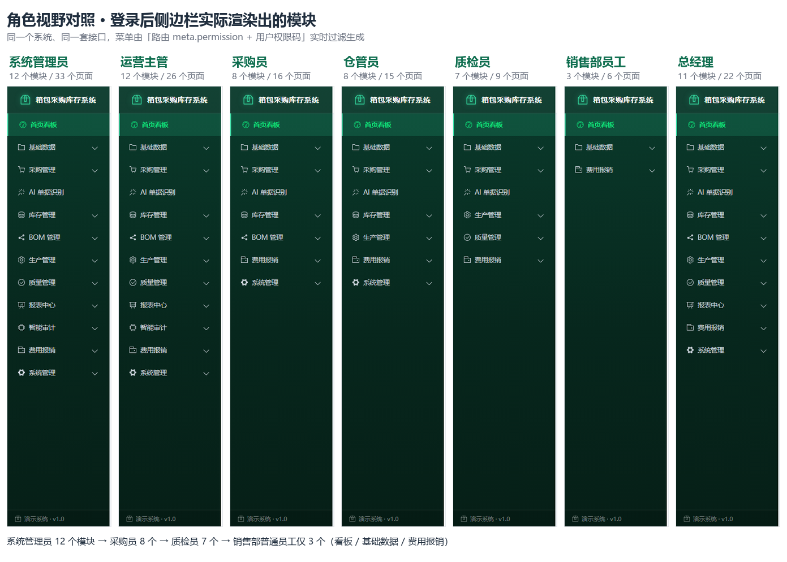
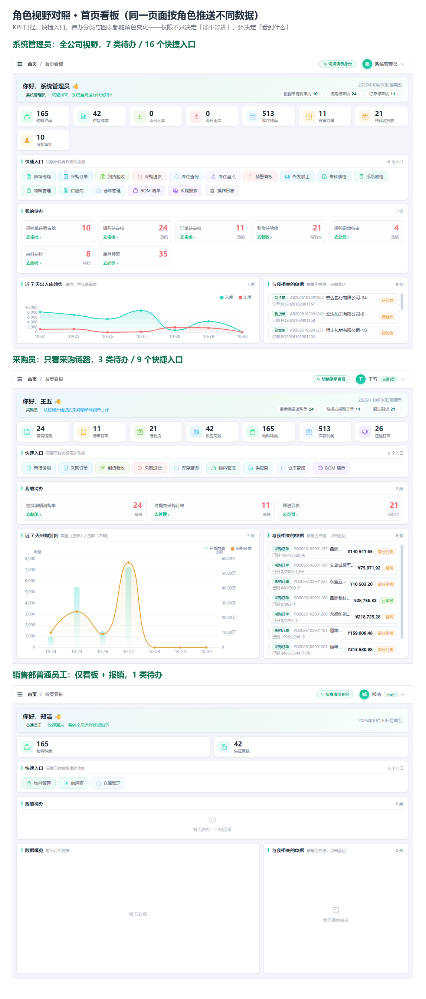
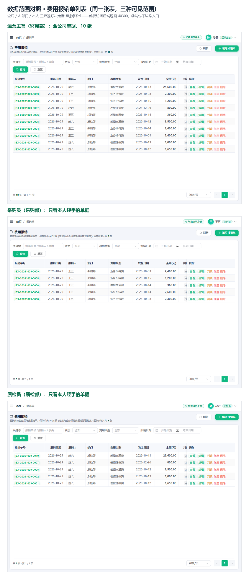

# 箱包制造企业采购与库存管理系统

面向箱包制造企业的一体化业务演示系统，覆盖 **物料主数据 → BOM 算料 → 请购 → 采购订单 → 到货检验 → 退货 → 出入库库存 → 盘点 → 报表** 的完整链路，并内置 **AI 单据识别**（送货单 / 发票照片 → 结构化物料明细 → 一键生成到货单，**识别引擎可在界面上配置并即时切换**）、**费用报销智能体**（票据识别 → 制度合规判读 → AI 制证 → 复核）与 **采购付款循环智能审计**（十项审计程序 → 审计发现与工作底稿），按 **用户 / 角色 / 权限码** 三级做了细粒度的功能权限控制。

本仓库为**教学与演示用途**，内置一套开箱即用的演示数据，可直接启动体验。

---

## 一、技术栈

| 层 | 技术 |
| --- | --- |
| 后端 | Python 3 / FastAPI / SQLAlchemy 2.0 / Pydantic v2 / PyJWT / bcrypt / openpyxl |
| 数据库 | SQLite（单文件，零安装；`backend/data/app.db`） |
| 前端 | Vue 3 / Vite 6 / Element Plus / Pinia / vue-router / ECharts / axios |
| 鉴权 | JWT（Bearer Token）+ 基于权限码的 RBAC |

---

## 二、目录结构

```
箱包制造企业采购与库存管理系统/
├── backend/
│   ├── app/
│   │   ├── api/            # 路由层：v1/ 下按业务模块拆分，deps.py 提供鉴权与权限依赖，
│   │   │                   #   _batch.py 提供批量操作的统一执行与逐动作鉴权
│   │   ├── core/           # 配置、数据库会话、安全（JWT/密码哈希）
│   │   ├── crud/           # 通用 CRUD 基类与鉴权查询
│   │   ├── models/         # SQLAlchemy 模型
│   │   ├── schemas/        # Pydantic 出入参模型
│   │   ├── services/       # 领域服务（stock_service 是库存台账的唯一入口，audit_service 是审计规则引擎，
│   │   │                   #   ai_model_config 负责解析「启用中的模型档案」并供 ai 相关服务读取）
│   │   ├── utils/          # 统一响应、单据号生成
│   │   └── main.py         # 应用入口、路由挂载、操作日志中间件（异步批量落库）
│   ├── data/app.db         # SQLite 演示库
│   ├── data/uploads/ocr/   # AI 识别时归档的原照片（运行时产物，重置脚本会一并清理）
│   ├── scripts/            # 建库 / 升级 / 造数 / 重置脚本
│   ├── .env.example        # 配置样例
│   └── requirements.txt
├── frontend/
│   ├── src/
│   │   ├── api/            # 接口封装，按模块拆分
│   │   ├── components/     # 公共组件（详情弹窗、排序标签、批量操作工具条 BatchBar）
│   │   ├── composables/    # 组合式函数（排序、图表、批量操作 useBatch 等）
│   │   ├── directive/      # v-permission 权限指令
│   │   ├── layout/         # 整体布局、顶栏与侧边菜单
│   │   ├── router/         # 路由表（含页面级权限元信息）
│   │   ├── store/          # Pinia 状态（当前用户与权限集合）
│   │   ├── utils/          # axios 封装、Token、下载、打印
│   │   └── views/          # 页面
│   ├── vite.config.js      # 别名 @ 与 /api 开发代理
│   └── package.json
├── docs/screenshots/       # 界面验收截图（1600×900）+ 角色视野对照图（1440×900）
├── test_docs/              # AI 单据识别的测试样张（送货单图片）
├── .gitignore
├── 代码审查报告.md
└── 功能改进建议.md
```

---

## 三、快速开始

> 需要 Python 3.10+ 与 Node.js 18+。
> **注意：后端必须从 `backend` 目录启动** —— 数据库地址 `sqlite:///./data/app.db` 是相对当前工作目录解析的。

### 1. 启动后端

```powershell
cd backend

# 首次运行：创建虚拟环境并安装依赖
python -m venv .venv
.\.venv\Scripts\python.exe -m pip install -r requirements.txt

# 首次运行：一条命令完成「建表 + 造演示数据 + 初始化角色权限」
# （内部按依赖顺序执行 scripts/ 下的 init_db → upgrade_db* → seed_data → setup_roles，
#   不要只单独跑 init_db.py 或 setup_roles.py，那样会漏建权限码与演示账号）
.\.venv\Scripts\python.exe scripts\reset_demo_data.py

# 启动服务
.\.venv\Scripts\python.exe -m uvicorn app.main:app --host 127.0.0.1 --port 8000
```

启动后：

- 接口文档（Swagger）：<http://127.0.0.1:8000/docs>
- 健康检查：<http://127.0.0.1:8000/health>

### 2. 启动前端

```powershell
cd frontend
npm install
npm run dev
```

浏览器访问 **<http://localhost:5173>**。开发服务器已把 `/api` 代理到 `http://127.0.0.1:8000`，因此本地开发**不涉及跨域**配置。

生产构建：`npm run build`（产物在 `frontend/dist`）。

---

## 四、演示账号

共 12 个账号，密码统一为 **`admin123`**（登录页已预填并提供账号下拉，可直接切换体验）。
登录页与顶栏「切换演示身份」均显示「**姓名 / 部门·职位 / 账号**」，方便按岗位选择身份。
账号列表**按「部门 → 职位」排序**：系统管理员最前，其后依次是总经办、财务部、销售部、
采购部、仓储部、质检部、信息技术部；同部门内管理岗在前、执行岗在后。
前 5 个是采购与库存业务岗位；其余 7 个是**报销职能岗位**（分级审批 + 财务制单复核 + 各部门报销人）。

> **两类账号已打通**（`scripts/merge_reimburse_into_business.py`）：7 个报销岗位原本只有
> `reimburse:*` 权限，首页只显示报销工作台，看不到系统其余功能。现在它们也能进入采购库存看板，
> 并把**本职的报销待办置顶**（待我审批、待制证、待复核、判读不合规）。
> 写入能力（新增 / 编辑 / 删除 / 审核 / 盘点调整）仍然只属于业务岗位 —— 报销岗拿到的一律是 `:list` / `:view`。

### 视野按「部门 × 职位」分级

业务视野不是一刀切，而是由 `app/core/visibility.py` 按角色的**部门与职位**决定
（`scripts/tune_visibility_by_dept_position.py` 落库）：

| 视野档位 | 角色（部门） | 可见模块 |
| --- | --- | --- |
| **全公司** | 总经理（总经办）、财务审批/制单/复核（财务部） | 14 项完整只读：物料 / 供应商 / 仓库 / 库存 / 采购单据 / BOM / 质检 / 外发 / 报表 / AI 记录（**不含操作日志**，该权限只授予系统管理员） |
| **本部门** | 部门负责人、部门总监（销售部） | 基础主数据 + **本部门请购单**（行级按 `dept` 过滤，22 条） |
| **仅本人** | 普通员工（销售部 / 信息技术部） | 仅基础主数据（填单够用），无业务单据与报表 |

5 个采购库存业务岗位（admin / manager / buyer / keeper / qc）本就是全公司工作范围，不受收窄影响。

> **为什么部门档位只开请购单**：当前 schema 里只有 `purchase_requisitions` 带 `dept` 字段，
> 采购订单、到货、退货、库存流水、质检、外发**都没有部门归属列**，`purchase_orders.pr_id` 也全为 NULL。
> 这些表无法按部门切分，给部门管理岗看就等于放行全公司数据，因此一律不开——宁可少给，也不越权。
> 列表与详情接口都做了同样的过滤（知道 id 也无法绕过），看板上的请购口径与列表一致。

### 4.0 采购与库存业务岗位

四个业务账号均已补真实姓名并归入对口部门（`scripts/reorganize_business_users.py`）；
系统管理员不属于任何业务部门。

| 用户名 | 姓名 | 部门 | 角色 | 权限范围 | 用户级权限调整 |
| --- | --- | --- | --- | --- | --- |
| `admin` | 系统管理员 | **无（独立）** | admin | 全部权限（含用户与角色权限管理、制度管理） | — |
| `manager` | **陈静** | **财务部** | manager | 全局只读（不含操作日志）+ 各类单据审核 + 报销制单 + 智能审计 | — |
| `buyer` | **王五** | **采购部** | buyer | 采购制单（请购 / 订单 / 到货 / 退货） | **单独禁用** `ai:ocr:import` |
| `keeper` | **孙七** | **仓储部** | keeper | 库存收发存、盘点、仓库调拨 | — |
| `qc` | **赵六** | **质检部** | qc | 来料与成品检验 | **额外授予** `ai:ocr:recognize` |

> **组织架构**：财务部、销售部、信息技术部、行政部、总经办、**采购部**、**仓储部**、**质检部**。
> 原先 `buyer` / `keeper` / `qc` 分别挂在销售部 / 行政部 / 信息技术部，与岗位不对口；
> 现按职能新建三个部门并归位。`manager`（陈静）保留在财务部 —— 制度第四条的
> 「财务复核（陈静）」点名她在财务岗位。

### 4.1 费用报销专用岗位

#### 分级审批岗（按《报销管理制度》第四条创建）

| 用户名 | 姓名 | 部门 | 角色 | 审批层级 | 可审批金额 |
| --- | --- | --- | --- | --- | --- |
| `depthead` | 李强 | 销售部 | 部门负责人 | 1 级 | 低于 5,000 元 |
| `director` | 王建国 | 销售部 | 部门总监 | 2 级 | 5,000 ～ 20,000 元 |
| `gm` | 张总 | 总经理 | 总经理 | 3 级 | 20,000 元以上 |
| `manager` | 陈静 | 财务部 | 财务复核（兼运营主管） | 1 级 | 低于 5,000 元 |

> **审批权限向上兼容**：总经理可审批任意金额，部门负责人不能越权审批大额单据。
> 报销人不能审批自己提交的单据（与制单、复核一致的自审防范）。

#### 财务制单 / 复核岗

| 用户名 | 姓名 | 部门 | 角色 | 报销能力 |
| --- | --- | --- | --- | --- |
| `finmaker` | 吴强 | 财务部 | 制单员 + 财务审批 | **财务制单**：AI 制证、凭证保存、审批、判读、人工覆盖（不能复核）|
| `finance` | 周敏 | 财务部 | 复核员 + 财务审批 | **财务复核**：复核通过 / 退回修改、审批、判读、人工覆盖（不能制单）|
| `sales` | 郑洁 | 销售部 | 普通员工 | 报销人：填写本人报销单、执行 AI 判读 |
| `tech` | 冯磊 | 信息技术部 | 普通员工 | 报销人：同上 |

> **为什么财务要拆成两个账号**：系统要求"制单人不能复核自己制作的凭证"（职责分离控制）。
> 若把制单与复核合并成一个财务账号，演示 `finance` 复核 `finmaker` 制作的凭证时必然被拦截。
> `finance`（复核）与 `finmaker`（制单）分离，才能完整演示"财务制单 → 财务复核"的真实流程。

> **`maker` / `reviewer` 两个通用账号已删除**：它们没有员工档案与部门归属，
> 与财务部的吴强 / 周敏职能重复。`maker`、`reviewer` 两个**角色**仍保留，
> 由吴强、周敏使用。删除脚本：`backend/scripts/remove_generic_maker_reviewer.py`。

> **新增方式**：
> - `backend/scripts/add_reimburse_users.py`（幂等）—— 报销人账号与「普通员工」角色
> - `backend/scripts/add_approval_roles.py`（幂等）—— 制度第四条的分级审批角色+账号，
>   同时给报销单补充审批留痕字段

> 登录后还可以用**顶栏右上角的「切换演示身份」**在下拉里直接切换账号，无需退出重新登录 —— 侧边菜单会按新角色的权限即时重算。
>
> 「用户级权限调整」列是**用户级权限覆盖**的演示数据（`scripts/setup_roles.py` 内置）：`qc` 本属角色只有 AI 识别查看权，被单独授予上传识别；`buyer` 虽属角色可导入，但该权限被单独禁用（识别结果须由主管复核后导入）。在**用户管理 → 配置权限**里可以看到这两条覆盖的勾选状态。

### 4.2 三级权限模型

权限判定是**权限码（permission）**级别的，共 72 个权限码，按模块分组（`dashboard` / `basic-data` / `purchase` / `inventory` / `bom` / `outsource` / `qc` / `report` / `system` / `ai` / `reimburse` / `audit`）：

```
用户 ──(user_roles)──> 角色 ──(role_permissions)──> 权限码
  └──(user_permissions)──> 权限码 + effect(grant|deny)   ← 用户级覆盖
```

**有效权限 = （全部角色权限 ∪ 用户级 grant）− 用户级 deny**，`deny` 优先级最高。

| 层级 | 配置入口 | 作用范围 |
| --- | --- | --- |
| 角色级 | 角色权限管理 → 配置权限 | 该角色下所有用户，权限树按模块勾选 |
| 用户级 | 用户管理 → 配置权限 | **仅该用户**，可额外授予或单独禁用某个权限码 |

用户级配置页的勾选状态**就是该用户最终生效的权限**：勾上一个角色没有的权限＝额外授予，取消一个角色已有的权限＝单独禁用（不影响所属角色），「还原为角色权限」可一键清空覆盖。后端 `app/api/deps.py` 的 `require_permissions` 会先查用户级 `deny`（即使 `admin` 也拦得住），再走角色权限判断；`GET /auth/userinfo` 会额外返回 `denied_permissions`，前端 `store.hasPermission` 与 `v-permission` 指令据此在 `admin` 短路之前先拦截被禁用的权限。

**批量操作复用同一套权限判定**：多个批量动作共用 `POST /xxx/batch` 一个端点，由请求体 `action` 区分（`app/api/_batch.py` 的 `run_batch_guarded`），因此不能靠单一路由依赖声明权限，而是为每个动作映射权限码后再逐一 `ensure_perm`（与 `require_permissions` 判定顺序完全一致：用户级 deny → admin 放行 → 权限码命中）。批量端点**逐条独立事务**，一条失败不回滚已成功项，部分成功是正常结果并会把逐条失败原因返回给前端。例：`backend/app/api/v1/materials.py` 的 `BATCH_PERMS = {"enable": "basic:material:edit", "disable": "basic:material:edit", "delete": "basic:material:delete"}`（启用/停用算编辑，删除单独要删除权，避免能编辑就能删）。

**AI 单据识别模块的权限矩阵**（5 个权限码，接口级鉴权在 `app/api/v1/ai_ocr.py`）：

| 权限码 | 说明 | admin | manager | buyer | keeper | qc |
| --- | --- | --- | --- | --- | --- | --- |
| `ai:ocr:list` | 查看识别记录、引擎信息 | ✅ | ✅ | ✅ | ✅ | ✅ |
| `ai:ocr:recognize` | 上传图片并识别（含批量） | ✅ | — | ✅ | ✅ | ✅（用户级授予） |
| `ai:ocr:import` | 核对后导入生成到货单 | ✅ | — | ❌（用户级禁用） | ✅ | — |
| `ai:ocr:delete` | 删除识别记录 | ✅ | — | — | — | — |
| `ai:ocr:config` | 管理大模型档案（新增 / 编辑 / 启用 / 测试 / 删除） | ✅ | — | — | — | — |

> 模型档案里存的是**识别引擎的接口地址与 API Key**，属于敏感配置，所以 `ai:ocr:config` 只授予系统管理员：业务岗位只使用识别能力，看不到也改不了密钥。档案密钥在接口返回时脱敏（只留末 4 位），列表页也只展示脱敏值。

### 4.3 角色视野与权限差异（实测）

同一套后端接口、同一份数据，12 个演示账号登录后是 12 种界面 —— 这正是三级权限模型要演示的效果。差异出现在三个层面：

| 层面 | 实现位置 | 表现 |
| --- | --- | --- |
| **菜单可见性** | 路由 `meta.permission` + 侧边栏按权限递归过滤（`router/guard.js`、`layout/index.vue`） | 销售部普通员工只看到 3 个模块，系统管理员看到 12 个 |
| **页面内动作** | `v-permission` 指令 + 批量动作逐条鉴权（`api/_batch.py`） | 同一张请购单，`admin` / `manager` 有「批量审核 / 退回 / 作废」，`buyer` 只有「导出选中」 |
| **数据范围** | `app/core/visibility.py` 的「全局 / 本部门 / 本人」三级视野，列表与详情同样过滤 | 运营主管看到全公司 10 张报销单，采购员与质检员各自只看到经手的 5 张 |

**实测：逐账号登录后侧边栏真实渲染出的模块与页面数**（1440×900 无头 Edge，抓取 DOM，非人工统计）

| 账号 | 角色 | 可见模块 | 可见页面 | 典型差异 |
| --- | --- | --- | --- | --- |
| `admin` | 系统管理员 | 12 | 33 | 唯一能看到「用户管理 / 角色权限管理 / 操作日志」的账号 |
| `manager` | 运营主管（财务部） | 12 | 26 | 有智能审计；但库存无「盘点」、报销无「待制证 / 凭证复核 / 制度管理」、系统管理只剩「导入导出」 |
| `finance` / `finmaker` | 财务复核员 / 制单员 | 11 | 22 | 业务数据全局只读 + 各自的制证 / 复核子菜单（职责分离） |
| `gm` | 总经理 | 11 | 22 | 全局只读，但没有智能审计与操作日志 |
| `buyer` | 采购员 | 8 | 16 | 没有生产 / 质量 / 报表 / 智能审计，采购四页全开 |
| `keeper` | 仓管员 | 8 | 15 | 采购下只有「到货入库 / 采购退货」，库存五页全开（含盘点与预警） |
| `qc` | 质检员 | 7 | 9 | 基础数据无「仓库管理」，采购下只有「到货入库」 |
| `depthead` / `director` | 部门负责人 / 部门总监 | 4 | 6 | 采购下只有本部门「请购单」，报销只有「报销单 / 凭证列表」 |
| `sales` / `tech` | 普通员工 | 3 | 6 | 只剩看板 + 基础数据 + 报销（填自己的单） |



三张对照图都在 `docs/screenshots/`，是无头 Edge 逐账号登录实拍后拼接的：

1. **菜单对照**（`40-roles-menu-compare.png`）：7 个账号的侧边栏并排，模块数与页面数直接标在列头，一眼能看出「权限收窄」发生在哪一级。
2. **首页看板对照**（`41-roles-dashboard-compare.png`）：同一个 `GET /reports/workbench`，系统管理员拿到全局口径（7 类待办、16 个快捷入口、近 7 天出入库趋势），采购员换成采购口径（3 类待办、9 个入口、采购到货数量/金额图），销售部普通员工只剩基础数据（0 类待办、3 个入口，主图表与「与我相关的单据」为空）。



3. **数据范围对照**（`42-roles-reimburse-scope-compare.png`）：同一张费用报销单表，运营主管看到全公司 10 张，采购员与质检员各看到自己经手的 5 张 —— 差异发生在 SQL 过滤条件，而不是前端隐藏。



> 越权不只是「看不见」：前端不渲染入口，直接请求后端接口同样会被 `require_permissions` 拦下并返回 `40300 无操作权限`。两侧都要过关，才算完整的功能权限控制。
>
> 想自己复现这组对照：登录任一账号后用顶栏右上角的「切换演示身份」逐个切换即可，菜单会按新角色即时重算。

### 4.4 GitHub 快捷登录（可选）

把演示地址发给别人体验时，登录页可以在配置了 GitHub OAuth App 之后多出一个「使用 GitHub 登录」按钮：

| 变量 | 默认值 | 说明 |
| --- | --- | --- |
| `GITHUB_OAUTH_ENABLED` | `true` | 总开关；关掉后按钮不显示，接口返回「未启用 GitHub 登录」 |
| `GITHUB_CLIENT_ID` / `GITHUB_CLIENT_SECRET` | 空 | 在 GitHub → Settings → Developer settings → OAuth Apps 新建应用后填入 |
| `GITHUB_REDIRECT_URI` | `http://127.0.0.1:8000/api/v1/auth/github/callback` | 必须与 OAuth App 里填的回调地址**完全一致** |
| `GITHUB_FRONTEND_URL` | `http://127.0.0.1:5173` | 授权完成后跳回的前端地址 |
| `GITHUB_ADMIN_ROLE` | `admin` | 首次登录的 GitHub 用户被绑定的角色 |

流程（后端 `app/services/github_oauth.py` + `api/v1/auth.py` 的四个端点）：

1. 点按钮 → `GET /auth/github/login` 生成一次性 `state` 后 302 到 GitHub 授权页（scope 只要 `read:user`，不读邮箱、不读仓库）；
2. GitHub 回调 `GET /auth/github/callback` → 校验 `state`、用 `code` 换 token、拉取用户资料，再按 `login` 建/取本地账号（用户名统一加 `gh_` 前缀，避免顶掉内置 `admin`）并绑定 `GITHUB_ADMIN_ROLE`；
3. 后端不把 token 交给浏览器，而是签一张 **60 秒一次性票据**，302 回前端 `#/login?gh_code=...`；前端用 `POST /auth/github/exchange` 换正式 JWT，随即 `router.replace` 抹掉地址栏里的参数；
4. 没配凭证时按钮不出现、接口给中文提示；`state` 与票据都一次性，重复使用会被拒并回跳登录页显示原因。

> **安全提示**：按当前配置，任何 GitHub 账号登录进来都会拿到 `admin`，这是**演示取舍**（方便外部同学直接看到全部功能）。若要长期对外开放，至少把 `GITHUB_ADMIN_ROLE` 换成只读角色。另外 `state` 与一次性票据都存在**单进程内存**里，多进程（`uvicorn --workers`）或多副本部署必须换成 Redis 之类的共享存储 —— 与登录失败的计数同一限制。

---

## 五、功能清单

**主数据**：物料档案、供应商档案、仓库与库位、缸号/批次、成品与 BOM 版本管理
**采购业务**：请购单 → 采购订单（含作废）→ 到货单 → 来料/成品检验 → 采购退货
**库存业务**：库存查询、出入库流水、库存调整、库存盘点（建单 / 录数 / 审核）、**仓库调拨**
**智能辅助**：BOM 算料（按 BOM 与库存算净需求）、**算料结果一键生成请购单**、低库存预警与**一键补货生成请购单**、**AI 单据识别**（上传送货单/发票照片 → 提取单号、供应商、物料、数量 → 核对后一键生成采购到货单；支持**一次多选图片批量串行识别**并逐张回显状态与失败原因；**识别时会把上传的原照片归档留存**，识别记录列表有「照片」列、核对弹窗内可对照原图并点击放大；仓库 `test_docs/` 下有可直接试用的送货单样张；识别引擎**在页面上可配置**——「模型配置」抽屉里新建多份档案（通义千问-VL / 豆包视觉 / 智谱 / OpenAI / 自定义网关），填地址、模型、API Key 后点「启用」即时生效，不必改 `.env` 或重启后端，详见 [五、功能清单](#五功能清单) 下方说明）
**报表看板**：工作台（按角色权限自适应的 KPI + 待办 + 主图表 + 相关单据）、采购与库存在线图表、多维采购/库存下钻报表
**批量操作**：**所有列表页均可勾选多行做批量处理** —— 业务表支持批量审核 / 驳回 / 作废 / 过账 / 启用停用 / 删除等（复用各行已有的操作语义与权限），只读表（库存查询、流水、报表、日志、BOM 算料）支持**批量导出选中**；勾选跨页保留，结果按「成功 N 条 / 失败 M 条」反馈并逐条列出失败原因
**数据交换**：主数据与单据的 Excel 导出、带填写说明的导入模板、批量导入（整份校验通过才写入）
**费用报销**：**差旅与业务招待费报销智能体** —— 填单上传 → AI 票据识别 → 人工确认 → AI 对照制度逐条合规判读（R01～R14）→ AI 生成记账凭证 → 制单员确认 → 复核员复核。含 16 张数据表、14 项检查规则、7 项应用控制（职责分离、人工覆盖受控、凭证号连续、审计轨迹等）。详见 [docs/差旅报销模块-使用说明.md](docs/差旅报销模块-使用说明.md)
**智能审计**：**采购付款循环审计智能体** —— 以只读模式审计本系统自己的业务库，10 项审计程序（请购超量、到货入库差异、订单账龄、价格偏离、退货来源、验收及时性、供应商集中度、采购与库存匹配、三单匹配、订单空转）按配置阈值自动命中，输出带证据链与审计建议的审计发现清单和工作底稿（按程序分册）；含工作台 KPI、风险等级分布、六阶段作业轨迹与执行日志。详见下文「六、智能审计模块」。
**操作日志**：**记录全系统每一次接口调用**（含查询、登录、失败请求，不只是写操作）—— 操作人、方法、请求路径、查询条件、HTTP 状态 / 业务错误码、耗时、IP、User-Agent，并附业务明细 `detail`：写操作记业务字段变化，**登录请求记账号与尝试结果**（成功 / 密码错误 / 已锁定，含该账号已连续失败次数与剩余锁定秒数）。页面提供总量 / 今日操作 / 今日活跃账号 / 今日失败 四项统计、近 7 日走势、按用户 / 结果 / 方法 / 关键字 / 日期范围筛选、单条详情（含 User-Agent 与业务明细 JSON）与导出；结果列直接显示「密码错误」「已锁定」，不必再对照错误码。日志由中间件**异步批量落库**（不占请求链路），默认保留 90 天自动清理。**登录失败同时触发限流**：同一账号 5 分钟内连续失败 5 次锁定 5 分钟，锁定期内即使口令正确也拒绝。**仅系统管理员可见**：`system:log` 权限只授予 `admin`，运营主管与报销审批岗一律没有该权限（审计轨迹不能被被审计对象看到）。
**系统管理**：用户管理（**含逐用户的权限配置**）、角色权限管理（权限树勾选）、操作日志（仅管理员）、单据打印

---

## 六、智能审计模块（审计端）

面向「采购付款循环」的审计智能体：以**只读**方式打开本系统自己的业务库，把审计程序固化成可执行的规则，跑一轮即产出「审计程序执行情况 + 审计发现清单（含证据链与审计建议）+ 审计工作底稿」。业务端解决"业务怎么办"，审计端回答"这些业务合理吗"——两者共用同一份数据，但**权限独立、连接只读**。

### 6.1 工作方式：六阶段作业

`AuditAgent`（`backend/app/services/audit_service.py`）按审计作业的真实顺序分六步执行，每步都记录实际耗时与产出摘要，工作台的「执行日志」直接来自这里：

| 阶段 | 做什么 | 实现 |
| --- | --- | --- |
| ① 审计立项 | 载入审计配置，确定审计期间、审计范围与重要性水平 | `_setup_scope` / `calc_materiality` |
| ② 数据采集 | 只读连接被审计库，逐表统计纳入审计的 10 张业务表记录数 | `_collect_data` |
| ③ 数据清洗 | 剔除作废单据、单价为空或为零的明细、缺仓库的到货明细 | `_clean_data` |
| ④ 规则校验 | 逐项执行 R01～R10 十个审计程序，登记命中条数 | `_run_procedures` |
| ⑤ 智能体判定 | 计算风险分值、排序、重编发现编号（F001…），汇总总体风险 | `_judge_findings` |
| ⑥ 生成底稿 | 按审计程序归集发现，形成底稿分册与证据、单据统计 | `_build_workpaper` |

**只读约束**：连接串固定为 `file:<db>?mode=ro`（SQLite URI 只读模式），程序内部只发 `SELECT` —— 审计规则写错也改不到被审计数据。

**重要性水平**：审计期间采购订单总额 × `materiality_ratio`（默认 1%），向下取整到百元；它同时是单笔金额的关注线，参与风险加权。

**风险分值**：等级基分（高 72 / 中 50 / 低 30）+ 金额加权（达到重要性水平得 15 分，超出部分按对数增长，封顶 22），最终取 `min(100, round(分值))`。

**总体风险**：高风险发现 ≥ 5 条即「高」；高风险 ≥ 1 条或中风险 ≥ 8 条为「中」；否则「低」。

### 6.2 十个审计程序

| 编号 | 程序 | 判定规则（默认阈值） | 命中后的发现等级 |
| --- | --- | --- | --- |
| R01 | 请购—订单数量一致性检查 | `ordered_qty > qty × 1.0`，转单数量超出批准请购量 | 超出 30% 为高，否则中 |
| R02 | 到货数量与入库数量匹配检查 | `abs(arrived_qty − inbound_qty) > 0.001` | 差异率 < 20% 中，≥ 20% 高 |
| R03 | 采购订单账龄分析 | 状态 ∈ 已审核 / 部分到货，且账龄 > 60 天 | 超过 90 天且金额 ≥ 重要性水平为高，否则中 |
| R04 | 采购价格合理性分析 | 同一物料供应商数 ≥ 2、可比报价 ≥ 3 笔，最高单价 ÷ 最低单价 > 2 | 中 |
| R05 | 采购退货来源合法性检查 | (a) 退货单未关联采购订单；(b) 退货量 > 该物料累计合格入库量 | 高 |
| R06 | 到货验收及时性检查 | 状态为待验收且超过 7 天未验收 | 中 |
| R07 | 供应商集中度分析 | 单一供应商采购额占比 > 30% | 低 |
| R08 | 采购与库存匹配性检查 | 订单已完成或部分到货，但该物料全仓库存余额为 0 | 中 |
| R09 | 三单匹配检查（订单—到货—入库） | `inbound_qty > arrived_qty`，即入库多于到货（无单入库嫌疑） | 高 |
| R10 | 订单执行情况检查 | 状态 ∈ 已审核 / 部分到货，且到货单数为 0 | 中 |

阈值全部集中在 `AUDIT_CONFIG["params"]`，换被审计单位或调整审计策略只改配置；每个程序是独立方法，内部封装该程序的审计目标、判定规则与阈值，便于单独增删与验证。

> 明细发现按程序做了限量（R06 最多展开 12 条，R05 的超量退货与 R08 最多 10 条，其余按金额降序取），避免同一类问题刷满底稿；完整命中条数看程序表的「命中」列。

### 6.3 四个页面

| 页面 | 路由 | 内容 |
| --- | --- | --- |
| 审计工作台 | `/audit/dashboard` | KPI 条（程序数与命中项、程序命中率、发现数与高风险数、涉及金额及占采购额比例）、审计程序执行情况表、风险等级分布图、审计范围与重要性水平、数据说明；页头「执行审计」强制重跑 |
| 审计发现 | `/audit/findings` | 按风险等级 / 审计程序 / 关键字筛选；表格含编号、等级、分值、程序、标题、涉及对象、金额；详情弹窗给出所属程序的目标与规则、**证据链**、**审计建议**、**关联单据**；支持「导出清单」 |
| 审计作业执行流程 | `/audit/workflow` | 六阶段流程条 + 进度条 + 逐步耗时、步骤明细、数据采集与清洗统计、执行日志、数据说明 |
| 审计工作底稿 | `/audit/workpaper` | 左侧按审计程序分册的目录（份数、金额），右侧该分册的发现清单（含审计建议），顶部报告元信息与审计范围；支持「导出底稿」 |

后端接口在 `backend/app/api/v1/audit.py`：`GET /audit/config`、`POST /audit/run`、`GET /audit/report`、`GET /audit/procedures`、`GET /audit/findings`、`GET /audit/findings/{id}`、`GET /audit/workpaper`。审计结果带 **1.5 秒 TTL 缓存**合并同一瞬间的并发请求，只有「执行审计」会强制真跑一遍。

### 6.4 权限与审计独立性

审计端只有 2 个权限码，由 `backend/scripts/upgrade_db_v5.py` 幂等补入：

| 权限码 | 说明 | admin | manager | buyer / keeper / qc |
| --- | --- | --- | --- | --- |
| `audit:view` | 进入工作台，查看审计程序与审计发现 | ✅ | ✅ | — |
| `audit:run` | 重新运行审计程序 | ✅ | ✅ | — |

> **为什么不给业务岗位**：被审计对象不应同时持有审计端权限，这是审计独立性要求在权限设计上的落点。`buyer` / `keeper` / `qc` 登录后侧边菜单里没有「智能审计」，直接敲 URL 也进不去（路由 `meta.permission` + 接口 `require_permissions` 双重拦截）。

### 6.5 在演示数据上的实测结果

> 重灌演示数据后跑一轮的结果，数字会随业务数据变化：

- 审计期间 2026-07-01 至 2026-10-19，期间采购总额 **¥11,266,496.50** → 重要性水平 **¥112,600.00**
- 采集 10 张业务表 **2,348** 条记录，清洗后 **2,348** 条参与校验（本轮无作废单据 / 单价 ≤ 0 明细）
- 10 项程序命中 8 项，形成 **44** 条审计发现（高 4 / 中 40 / 低 0），涉及金额 **¥4,654,094.18**，总体风险 **中**
- 分程序命中：R03 12、R04 13、R06 17、R05 19（18 张退货单未关联采购订单 + 1 条超量退货）、R01 1、R02 1、R08 1、R10 2；R07、R09 未命中
- 六阶段全流程耗时在几十毫秒量级（只读 SQLite，无写库动作）

> 每次 `reset_demo_data.py` 会重新随机生成业务数据，因此命中条数与涉及金额会有小幅浮动（量级与「哪几条程序命中」保持稳定），采购总额与重要性水平由配置与期间决定，不随重灌变化。

> **数据说明（报告首页也印了这段话）**：演示数据由测试脚本按随机规则生成，采购单价、供应商分配不服从真实价格规律，因此「价格合理性分析」这类程序的高命中率主要反映**数据生成特性**，不能据此推定存在舞弊；审计程序的设计逻辑本身可直接复用于生产数据。

### 6.6 已知边界

- **一次性只读快照**：不落库、不复用，每次执行重新全量扫描；审计发现没有状态流转（无整改跟踪、复核签章、底稿归档）。
- **只覆盖采购付款循环**：销售、费用报销不在 R01～R10 范围内（报销合规是另一个独立模块）。
- **`audit:run` 未单独校验**：`POST /audit/run` 当前校验的仍是 `audit:view`，即"能看就能重跑"；若要严格区分"查看"与"执行"，应把该接口改为依赖 `audit:run`。
- **无审计项目管理**：单次审计 = 单次请求，不支持多项目并行、期段对比或跨期留痕。

---

## 七、推荐演示动线

1. 用 `admin` 登录，看**工作台**（KPI 卡片、趋势图、库存 Top10、待办、快速入口）。
2. 打开**角色权限管理**，勾选/取消某个权限码并保存 → 用**顶栏切换演示身份**换成对应角色 → 观察**侧边菜单与页面按钮即时变化**。这是最能体现系统完整度的一步。
3. 切到 `buyer`：**BOM 算料** → 一键**生成请购单** → 在请购单里审核 → 生成**采购订单**。
4. 切到 `keeper`：做**到货入库** → 看**库存查询**与**出入库流水**变化 → 做一张**仓库调拨**（审核后两个仓库库存同步变动，作废可完全回滚）。
5. 打开**库存预警**，勾选几行 → **一键补货生成请购单**（会提示"已有待审请购 / 在途"的重复采购风险）。
6. 切到 `qc` 做**来料检验**，切回 `manager` 做**审核**，最后到**报表**看图表与下钻，并从**导入导出**下载模板、导出单据 Excel。
7. 打开 **AI 单据识别**，把 `test_docs/送货单_测试样张.png` 拖进上传区 → **开始识别** → 核对提取出的单号/供应商/物料明细 → **确认导入并生成到货单**；识别记录列表的**照片**列能直接看到原图缩略图，点「查看」打开核对弹窗后可对照**原照片**（点击图片放大）。也可以**一次拖入多张**，点「开始批量识别」看队列逐张变成「已识别」，再逐条核对导入（默认 `mock` 引擎离线可用，无需密钥）。想接入真实视觉模型时点页头右上角 **「模型配置」**：新建一份档案（选引擎会带出默认地址与模型）、填 API Key → **测试连接** → **启用**，页头的引擎标签立刻变成本次启用的档案，下次识别就调真实模型，全程不用改 `.env`、也不用重启后端。
8. 到**用户管理**点某行的**配置权限**：勾选一个角色没有的权限＝额外授予，取消一个角色已有的权限＝单独禁用，保存后**用顶栏切换成该用户**，菜单与按钮会立即按新权限变化（演示数据里 `qc` 被额外授予上传识别、`buyer` 被单独禁用导入）。
9. **批量操作**：在任意列表页勾选多行，表格上方会浮出批量工具条 —— 例如请购单页勾选后**批量审核 / 批量驳回**（驳回会要求填写原因）；故意混选一张非草稿单据，会看到「成功 N 条，失败 M 条」并弹出**失败明细**逐条说明原因（如"仅草稿可审核"）。只读页（库存查询、出入库流水、报表、日志、BOM 算料）的批量按钮是**导出选中**，导出带 BOM 的 CSV，用 Excel 打开中文不乱码；勾选状态**跨页保留**，换筛选条件自动清空。
10. **智能审计**：用 `manager`（陈静）登录 → 打开 **智能审计 → 审计工作台**，点「执行审计」看六阶段真实耗时 → 到 **审计发现** 按「高」筛选并打开详情，看证据链与审计建议 → 到 **审计工作底稿** 按程序分册查看并「导出底稿」 → 再换 `buyer` 登录，确认侧边菜单里根本没有「智能审计」（审计独立性）。
11. **操作日志（仅管理员可见）**：用 `admin` 打开 **系统管理 → 操作日志**，先看顶部四项统计与近 7 日走势，再按「结果 = 失败」筛选 —— 刚才演示中所有被拒绝的操作（例如 `buyer` 点了没有权限的按钮、输入错误的登录口令）都留了痕迹，结果列直接标着「密码错误」「已锁定」；点某行的「详情」能看到查询条件、耗时、User-Agent 与业务明细（登录记录里能读到该账号连续失败了几次）。可以故意把某个账号的口令连输 5 次，第 5 次会被临时锁定 5 分钟，日志里这一条的明细带着 `fail_count` 与 `remaining_seconds`。然后切到 `manager`，确认侧边栏里**没有**「操作日志」菜单、直接访问 `/system/logs` 也会被拦下（`system:log` 只授予系统管理员）。

---

## 八、演示数据重置

演示过程中会把数据改乱，一条命令即可恢复初始状态：

```powershell
cd backend
# 先停掉正在运行的后端服务（否则数据库文件被占用）
.\.venv\Scripts\python.exe scripts\reset_demo_data.py
```

该脚本会删除 `backend/data/app.db`，并清空 AI 识别原图归档目录 `backend/data/uploads/ocr/`（报销票据目录 `backend/data/uploads/rmb/` 不动），然后按依赖顺序执行 `backend/scripts/` 下的 28 个脚本，顺序不能随意调整：

1. **建表与基础数据**：`init_db.py`（建表 + 演示账号 + 基础权限）→ `upgrade_db.py` / `upgrade_db_v2.py` / `upgrade_db_v3.py` / `upgrade_db_transfer.py` / `upgrade_db_userperm.py` / `upgrade_db_v4.py`（补齐权限码、字段、调拨表、用户级权限表与 AI 原图归档列）
2. **业务数据**：`seed_data.py`（物料/供应商/仓库/BOM/库存/采购/质检/外发/调拨/AI 识别记录/日志）
3. **角色与账号**：`setup_roles.py`（角色权限、用户绑定与用户级权限覆盖）→ `upgrade_db_v6_reimburse.py`（报销的 16 张 `rmb_*` 表、报销权限码与科目/规则基础数据，并按 `ROLE_GRANTS` 给角色授报销权限）
4. **增量授权与收尾**（全部必须在 `setup_roles.py` 之后，因为它会先清空再重建角色权限）：`upgrade_db_v5.py`（智能审计权限码与 admin/manager 授权）→ `import_policy_text.py` → `add_approval_roles.py` → `link_reimburse_users.py` → `add_reimburse_users.py` → `reorganize_business_users.py` → `merge_reimburse_into_business.py` → `fix_finance_dept_permissions.py` → `fix_business_role_permissions.py` → `fix_admin_reimburse_approve.py` → `align_permissions_by_dept_position.py` → `tune_visibility_by_dept_position.py` → `restore_qc_permissions.py` → `remove_generic_maker_reviewer.py` → `enable_workbench_for_all_roles.py` → `seed_rmb_scenarios.py` → `upgrade_db_v7_oplog.py`（补 `operation_logs` 的审计列（状态码 / 耗时 / 查询条件 / UA）与两条复合索引，并把 `system:log` 收归 admin）→ `upgrade_db_v8_ai_model.py`（建 `ai_model_configs` 表、补 `ai:ocr:config` 权限码并只授 admin，表为空时插一条「离线演示引擎（mock）」并启用 —— **必须排在最后**）

五个容易踩的顺序坑（都已在脚本清单里处理）：

- `upgrade_db_v6_reimburse.py` 自身要求「请先运行 setup_roles.py」（角色不存在就跳过授权），且它属于增量授权，必须排在 `setup_roles.py` 之后；
- `link_reimburse_users.py` 负责创建 `maker` / `reviewer` 两个角色，必须排在 `add_reimburse_users.py` 之前，否则后者给 `finmaker` / `finance` 绑「财务制单 / 复核」时角色还不存在，会静默跳过，最后 `align_permissions_by_dept_position.py` 的财务岗职责分离校验会失败退出；
- `setup_roles.py` 里的角色权限是「先 delete 再重建」，任何增量授权放到它前面都会被整段抹掉（典型表现：审计菜单消失、报销菜单消失）；
- `upgrade_db_v7_oplog.py`（日志收权）必须排在链路最后：`setup_roles.py` 的重建、`tune_visibility_by_dept_position.py` 按视野补权限，都会把 `system:log` 重新发给管理岗，只有在最后收权才成立；
- `upgrade_db_v8_ai_model.py` 同理必须排在 `setup_roles.py` 之后：它新建的 `ai:ocr:config` 权限码要能被 `admin` 的「全部权限」快照收进去，而 `admin` 的权限集合是在 `setup_roles.py` 里按当时的权限码表算的。

重灌后有六处与「跑过一段时间的库」不同，属于预期行为：

- **报销单全部是「待判读」**：`seed_rmb_scenarios.py` 只生成单据，不跑 AI 合规判读（判读需要启动后端服务并调用大模型）。要演示判读结论，先启动服务，再用财务/审核账号在报销单详情页点「AI 判读」；
- **原图归档只剩样图**：清空的是 `backend/data/uploads/ocr/`，`seed_data.py` 会重新生成 2 条识别记录与 2 张样图；`backend/data/uploads/rmb/`（报销票据 PDF）不清空。若演示中需要「拍票识别 + 原图缩放」，重新上传即可；
- **部门负责人在本部门看不到场景单**：场景单（T03～T15）的报销人是王五（采购部）与赵六（质检部），而 `depthead` 李强、`director` 王建国属于销售部，其数据范围是「本部门」，因此登录后报销列表为 0 张。要演示审批链，用 `finance` / `finmaker`（全公司范围）或 `manager`；
- **业务数据重新随机生成**：采购单/到货单/库存台账的条数与单价每次不同，智能审计的命中条数会有小幅浮动（见 6.5 的说明）；
- **操作日志只有 150 条种子记录**：`seed_data.py` 生成的是历史模拟日志（全部记在 admin 名下、状态码 200），真实的操作留痕从重灌后第一次调用接口开始累积。启动服务、随便点几个页面，日志页就会多出记录（含 admin 自己查看日志的动作——该接口本身被中间件排除，不会自激刷屏）。日志由后台任务异步写入，接口返回后 0.3 秒内才落库，刷新页面时偶尔会晚一条；
- **模型档案只剩一条默认 mock**：`upgrade_db_v8_ai_model.py` 只在表为空时插「离线演示引擎（mock）」并启用，之前配好的真实模型档案（含 API Key）不会重建。要用真实视觉模型，重灌后到「AI 单据识别 → 模型配置」重新新建一份即可。

脚本结束后会**自检**并打印真实的账号数、权限码总数与各角色权限项（缺账号或权限码不全时直接报错退出，而不是打印一句成功），最后打印全部演示账号与口令。

---

## 九、配置说明

配置通过环境变量或 `backend/.env` 覆盖，字段见 `backend/.env.example`：

| 变量 | 默认值 | 说明 |
| --- | --- | --- |
| `DATABASE_URL` | `sqlite:///./data/app.db` | 数据库连接串，相对路径按后端工作目录解析 |
| `UPLOAD_DIR` | `./data/uploads` | 上传归档目录（AI 识别原照片存于其下 `ocr/` 子目录） |
| `SECRET_KEY` | 内置演示密钥 | **JWT 签名密钥，正式使用前必须改为随机长字符串** |
| `ACCESS_TOKEN_EXPIRE_MINUTES` | `1440` | 登录令牌有效期（分钟），默认 24 小时 |
| `CORS_ORIGINS` | `http://localhost:5173` | 允许跨域的来源，多个用英文逗号分隔 |
| `AI_OCR_PROVIDER` | `mock` | AI 单据识别引擎：`mock`（离线演示，无需密钥）/ `dashscope`（通义千问-VL）/ `ark`（豆包视觉）/ `zhipu`（GLM-4V）/ `openai` / `custom`。**只要「模型配置」里有启用的档案，就优先用档案参数**，这几项 `.env` 只作为没有启用档案时的回落值 |
| `AI_OCR_API_KEY` | 空 | 引擎密钥，`mock` 时可留空（同样会被启用档案覆盖） |
| `AI_OCR_BASE_URL` / `AI_OCR_MODEL` | 空 | 留空用所选引擎的内置预设，填写则以填写的为准（`custom` 必填） |
| `AI_OCR_TIMEOUT` / `AI_OCR_MAX_MB` / `AI_OCR_RETRY` | `60` / `8` / `1` | 单次识别超时（秒）、上传图片大小上限（MB）、网络异常重试次数 |
| `AI_OCR_JSON_MODE` | `true` | 是否携带 `response_format={"type":"json_object"}`，个别网关不支持时设为 `false` |
| `OPLOG_RETENTION_DAYS` | `90` | 操作日志保留天数，超期由后台任务清理（设为 `0` 表示不清理） |
| `OPLOG_BATCH_MAX` / `OPLOG_FLUSH_DELAY` | `200` / `0.3` | 异步落库的每批上限（条）与攒批等待（秒） |
| `LOGIN_MAX_FAILS` / `LOGIN_FAIL_WINDOW` / `LOGIN_LOCK_SECONDS` | `5` / `300` / `300` | 同一账号在窗口期（秒）内连续失败达到次数后临时锁定的秒数 |
| `LOGIN_IP_MAX_FAILS` | `20` | 同一 IP 在窗口期内连续失败的锁定阈值（演示环境所有请求都来自 `127.0.0.1`，故放宽） |
| `GITHUB_OAUTH_ENABLED` `/` `GITHUB_CLIENT_ID` `/` `GITHUB_CLIENT_SECRET` `/` `GITHUB_REDIRECT_URI` `/` `GITHUB_FRONTEND_URL` `/` `GITHUB_ADMIN_ROLE` | `true` / 空 / 空 / `http://127.0.0.1:8000/api/v1/auth/github/callback` / `http://127.0.0.1:5173` / `admin` | GitHub 快捷登录（可选）。没填 Client ID/Secret 时登录页不显示按钮。详见 4.4 节 |

> 默认的 `mock` 引擎用固定规则解析样张，**不需要任何密钥即可跑通「上传 → 识别 → 核对 → 生成到货单」全流程**；换成真实引擎只需改 `AI_OCR_PROVIDER` 与密钥，代码无需改动（适配层在 `backend/app/services/ocr_service.py`）。

---

## 十、已知局限（演示系统的边界）

本系统定位为**功能演示与教学**，以下方面有意保持简单，若用于真实生产需要额外加固：

- **并发安全**：库存扣减采用"先查后判"并在应用层校验，未使用行级锁或数据库约束，高并发下可能出现超卖；单据号由"前缀 + 时间戳 + 随机数"生成，极端并发下存在碰撞可能。
- **演示口令**：登录页预填 `admin123` 且提供账号列表接口，便于演示，**不可用于任何真实环境**。
- **数据规模**：列表与报表按演示数据量设计，部分查询有全表加载，大数据量下需要分页与索引优化。
- **无自动化测试**：仓库内没有单元测试与端到端测试，改动后依赖手工回归。
- **批量驳回原因不落库**：请购 / 订单 / 到货 / 退货 / 盘点 / BOM 的驳回原因会写入单据的 `reject_reason` 字段并在详情里显示；**来料质检（IQC）与成品质检（FQC）**的批量判定不合格原因目前仅前端强制填写，后端 `IqcOrder` / `FqcOrder` 没有该列，因此不会持久化。
- **无数据库迁移框架**：表结构变更通过 `backend/scripts/upgrade_db*.py` 手工脚本处理，未接入 Alembic。
- **智能审计的边界**：只读一次性快照、执行结果不落库，只覆盖采购付款循环，审计发现没有整改跟踪与复核签章；`POST /audit/run` 校验的仍是 `audit:view`，即"能看就能重跑"。详见第六节 6.6。
- **模型档案的密钥是明文存储**：`ai_model_configs.api_key` 以明文存进 SQLite（接口只做脱敏返回），适合内网演示环境；真实部署应改为加密存储或只从环境变量/密钥管理服务读取。档案切换只影响之后的识别请求，正在进行中的批量识别仍按启动时的参数跑完。
- **操作日志的边界**：记录的是**接口调用**（方法、路径、查询串、结果码、耗时、IP、UA）与业务层额外写入的 `detail` 明细，**不保存请求体 / 响应体原文**，因此不包含具体字段值（如把某物料单价从 12 改成 15 的两个值）；同一账号 2 秒内重复的相同查询只记一条（避免翻页、轮询把日志刷满），写操作不做去重；日志按 `OPLOG_RETENTION_DAYS`（默认 90 天）自动清理，不保留完整历史；落库走**进程内异步队列**（攒批 0.3 秒或 200 条一次），进程被强杀时最后不到 0.3 秒的记录会丢；登录失败计数只存在**当前进程内存**，多进程 / 多实例部署时各自计数、重启即清零（生产环境应换成 Redis）；「查看日志」接口本身不产生日志（防自激），因此"某管理员看过日志"这一动作不会留痕。

更完整的问题清单与逐条修复建议见 `代码审查报告.md` 与 `功能改进建议.md`。

---

## 十一、界面验收截图

`docs/screenshots/` 下是 26 个页面 + 4 个角色看板 + 2 张权限配置弹窗 + 2 张批量操作 + 3 张 AI 批量识别 + 2 张 AI 原照片在**统一基准**（1600×900、无头 Edge、`admin` 身份、重灌演示数据后）的整页截图，另有 3 张**角色视野与权限差异对照图**（1440×900，逐账号登录实拍后拼接，见 4.3 节）：

| 文件 | 页面 | 文件 | 页面 |
| --- | --- | --- | --- |
| `01-dashboard.png` | 首页看板（系统管理员） | `14-inventory-alert.png` | 预警看板 |
| `02-login.png` | 登录页 | `15-bom-list.png` | BOM 清单 |
| `03-materials.png` | 物料管理 | `16-bom-calculate.png` | BOM 算料 |
| `04-suppliers.png` | 供应商管理 | `17-iqc.png` | 来料质检 |
| `05-warehouses.png` | 仓库管理 | `18-fqc.png` | 成品质检 |
| `06-requisition.png` | 请购单 | `19-outsource.png` | 外发加工 |
| `07-purchase-order.png` | 采购订单 | `20-report-purchase.png` | 采购报表 |
| `08-arrival.png` | 到货入库 | `21-report-inventory.png` | 库存报表 |
| `09-purchase-return.png` | 采购退货 | `22-system-users.png` | 用户管理 |
| `10-inventory-query.png` | 库存查询 | `23-system-roles.png` | 角色权限管理 |
| `11-inventory-transactions.png` | 出入库流水 | `24-system-logs.png` | 操作日志 |
| `12-stocktake.png` | 库存盘点 | `25-system-excel.png` | 导入导出 |
| `13-transfers.png` | 仓库调拨 | `30-ai-ocr.png` | AI 单据识别 |
| `26-dashboard-manager.png` | 首页看板（运营主管） | `28-dashboard-keeper.png` | 首页看板（仓管员） |
| `27-dashboard-buyer.png` | 首页看板（采购员） | `29-dashboard-qc.png` | 首页看板（质检员） |
| `31-system-user-permissions.png` | 用户级权限配置弹窗（质检员） | `32-system-role-permissions.png` | 角色权限树弹窗 |
| `33-batch-select.png` | 批量操作（勾选 3 行后的工具条） | `34-batch-fail-detail.png` | 批量操作失败明细弹窗 |
| `35-ai-batch-queue.png` | AI 批量识别（3 张排队待识别） | `36-ai-batch-done.png` | AI 批量识别（3 张全部成功） |
| `37-ai-batch-fail.png` | AI 批量识别（1 成 1 败，逐张显示原因） | `38-ai-ocr-photo-dialog.png` | AI 核对弹窗内对照原照片 |
| `39-ai-ocr-photo-zoom.png` | AI 原照片点击放大（原始分辨率） | — | — |
| `40-roles-menu-compare.png` | **角色视野对照**：7 个账号的侧边栏并排 | `41-roles-dashboard-compare.png` | **看板对照**：管理员 / 采购员 / 普通员工 |
| `42-roles-reimburse-scope-compare.png` | **数据范围对照**：全公司 / 采购员本人 / 质检员本人 | — | — |

> `40`~`42` 三张对照图的基准与上面不同：**1440×900**、逐账号登录后抓取真实渲染结果（菜单图取侧边栏 DOM，看板与报销图取整页截图）再纵向/横向拼接；因为要在一张图里放下多个角色，列宽做了等比缩放。重灌演示数据后单据条数会变（报销单 10 张是当前这次重灌的值），图里的数字需要重跑脚本才能对齐，脚本未随仓库提供。
>
> 智能审计的 4 个页面（工作台 / 审计发现 / 作业执行流程 / 审计工作底稿）尚未纳入截图集，待补。
>
> `30-ai-ocr.png` 是加入「模型配置」按钮与抽屉**之前**的截图，待重拍；模型配置抽屉本身也还没有截图。
>
> `24-system-logs.png` 是操作日志页**改版前**的截图（旧版只有路径关键字筛选）。新版增加了统计条、用户 / 结果 / 方法 / 日期筛选、状态与耗时列、查询条件列与单条详情弹窗，该图待重拍。

统一界面约定：所有列表页由「页头（标题 + 一句话说明 + 右侧动作）+ 卡片（筛选工具栏 / 表格 / 底部固定分页）+ 页脚余白 13px」构成；表格数字列右对齐、长文本列带 tooltip；图表统一由 `src/composables/useChart.js` 渲染。

首页看板按**角色权限**自适应（`views/dashboard/index.vue`，数据来自 `GET /api/v1/reports/workbench`）：第 1~4 行（问候横幅 / 角色 KPI 卡条 / 权限过滤后的快速入口 / 我的待办）各自按内容高度收缩，只有第 5 行主区吸收剩余高度（左「角色主图表」+ 右「与我相关的单据」，单据少则拉高、多则面板内滚动），因此任何角色都不会出现成片空白。5 个角色实测最长空白带 16px（约 1.9%）、内容区末尾空白 0px；主图表分别为：管理员/主管「近 7 天出入库趋势」、采购员「采购到货数量 + 金额」、仓管员「各仓库存分布」、质检员「IQC/FQC 批次 + 一次合格率」（合格率为 `null` 的日期断点不连线）。

**AI 单据识别页**（`views/ai/ocr.vue`）上半区是「识别工作台」（流程引导 + 上传区 + 预览 + 开始识别），下半区「识别记录」卡撑满剩余高度、表格内部滚动、分页固定在卡底；页面上每个按钮都由权限码控制（`v-permission`），无导入权的角色（如演示数据里的 `buyer`）打开核对弹窗时看不到「确认导入」按钮。

**AI 模型配置抽屉**（同页，`ai:ocr:config` 仅管理员可见）：页头「模型配置」打开右侧抽屉，表格列出全部模型档案（配置名称 / 引擎·模型 / 接口地址 / API Key 脱敏值 / 超时·重试 / 启用状态），操作列可**启用 / 测试 / 编辑 / 删除**。新建或编辑时选「引擎类型」会自动带出该家的默认接口地址与模型名（`app/services/ai_model_config.py` 的 `PROVIDER_PRESETS`），只需补 API Key 与配置名称；「测试」直接拿这份档案（不必先启用）发一次真实请求，返回成功或把上游的 HTTP 错误原文展示出来，方便在校验配置时定位问题。「启用」是**即时生效**的：识别服务每次调用都从启用档案读参数（3 秒进程内缓存，写操作后主动失效），不需要重启后端；同一时刻只允许一条档案启用，启用新档案会自动把旧的置为未启用。删除当前启用的档案时，识别自动回落到 `.env` 配置并在抽屉顶部的提示条里说明。

**AI 批量识别**：上传区一次可选多张（拖拽或多选，最多 20 张），选 2 张以上即自动从「单张预览」切换为**文件队列**，逐张显示文件名 / 大小 / 状态（待识别 · 识别中 · 已识别 · 失败）；点「开始批量识别」后**串行逐张调用**视觉模型（真实模型串行更稳，也能逐张回显进度），进度条显示「识别中 2/3 · 文件名」。识别成功的逐张写入下方「识别记录」待人工核对导入（**不自动导入**，保留人工确认环节）；失败的留在队列里**逐张显示具体原因**（如"未能识别出单据内容：图片为几何图形…"），可用「重试失败」（或直接再点按钮）只重跑失败项；识别中途可点「停止」，会在当前这张结束后退出。单张识别保持原有体验：识别完自动打开核对弹窗。

**AI 原照片留存**（`backend/app/services/file_store.py`）：识别时把上传的原图**归档留存**，记录里只存相对路径（相对 `UPLOAD_DIR`，默认 `backend/data/uploads/ocr/`），文件名由「日期 + 记录 id + 内容摘要」生成而**不使用用户上传的原始文件名**（避免路径穿越与同名覆盖，原始名另存于 `image_name` 供展示）。因此：识别记录列表首列是**照片**缩略图（点击可放大），核对弹窗内也有「识别原照片」区可对照原图；取图接口 `GET /api/v1/ai-ocr/records/{id}/image` 需要 Bearer 头，所以前端统一用 axios 取 Blob 再转 objectURL（`` 带不了自定义头）。删除识别记录（含批量删除）会**一并清理归档文件**；归档文件被手工清理或历史记录没有原图时，`has_image` 为 `false`，该行显示「未留存」而**不是破图**，接口也返回友好文案而非 500。落盘失败（磁盘满、目录只读）不会让识别失败，只把该次记录降级为「未留存」。

**批量操作**（`composables/useBatch.js` + `components/BatchBar.vue` + `utils/exportRows.js`）：23 张列表页的表格首列都是勾选列（`reserve-selection` + `row-key`，勾选跨页保留），勾选后工具条**才**浮现在筛选栏下方——没勾选时不占位、不产生额外空白。工具条按钮同样按权限码过滤，所以同一页面不同角色看到的批量动作不同（例如请购单页 `admin`/`manager` 有「批量审核 / 批量驳回 / 批量作废」，`buyer` 只有「导出选中」）。只读页的批量动作是**导出选中**，前端直接生成带 UTF-8 BOM 的 CSV（不新增依赖、也不需要后端接口）；业务页则调用对应的 `POST /xxx/batch`，结果全成功只弹提示，有失败会再弹「失败明细」逐条列出 `#id 原因`（最多展示 50 条）。

> 度量口径：内容区 `x∈[250,1560)`、`y∈[60,886)` 逐行统计非背景像素，暗像素 ≤8 的行记为空白行。所有页面内容区**末尾**空白均为 0px（卡片底边压在 y=886）。仍存在的是**卡内留白**——表格自身按「行数 × 行高」渲染、不撑满卡片，行数少时行下方留空：`22-system-users` / `23-system-roles` 约 415px（5 条演示数据）、`16-bom-calculate` 约 254px、`05-warehouses` 约 198px、`12-stocktake` / `15-bom-list` 约 161px、`30-ai-ocr` 约 155px、`25-system-excel` 约 121px；其余页面留白 17~31px（约 2%）。这是演示数据量偏小所致，非版式缺陷。

## 十二、许可证

MIT License，见 [LICENSE](LICENSE)。

> 本项目定位为**功能演示与教学用途**：12 个演示账号口令统一为 `admin123`，`SECRET_KEY`、数据库文件与 AI 模型密钥均按演示标准配置。**请勿直接用于任何真实生产环境**；若要上线，至少需要更换 JWT 密钥、改用正式数据库、把模型密钥放进环境变量（而非界面配置），并按最小权限原则重新梳理角色。
>
> GitHub 快捷登录默认把新用户绑到 `admin` 角色（见 4.4 节），同样只适合演示；对外开放前请先改成只读角色。

